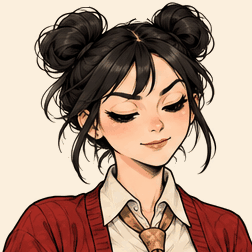

# InkAlive · 妙笔生动

**Bring illustrated characters to life, one carefully reviewed GIF at a time.**

[中文说明](README.zh-CN.md) · [Download skill](https://github.com/imxiaowho/ink-alive/releases/latest) · [Skill instructions](skills/ink-alive/SKILL.md)

InkAlive is a Codex skill with a local Python tool for creating and repairing short, single-shot character GIFs. It connects native image generation, reusable frame recipes, background and idle-layer stabilization, expression/action transitions, and evidence-based visual review.



The included Panna example is the project owner's accepted quality reference: 252 × 252, two seconds, 24 drawn keys and 26 inferred intermediate images. These numbers describe the example; they are not a universal quality target. The complete bundled recipe reproduces this exact GIF in the verified environment.

## Install

1. Download the standalone skill ZIP from [Releases](https://github.com/imxiaowho/ink-alive/releases/latest), or clone this repository.
2. Put the `ink-alive` folder in your Codex user skills directory. From the repository, copy `skills/ink-alive`; the default destination is `~/.codex/skills/ink-alive`.
3. Install the Python requirements in your chosen environment. Python 3.10+ is required.
4. Start a new Codex session if the newly installed skill is not yet listed.

From the repository root:

```sh
python -m pip install -r skills/ink-alive/requirements.txt
```

Invoke **`$ink-alive`**, or ask for **InkAlive / 妙笔生动**:

> Use $ink-alive to create one subtle eyebrow-raise loop for my character, following the accepted reference quality.

New drawings and raster repairs use the host's built-in imagegen tool. The Python helper does not generate art, need a GPU or call an external API. A source sheet is a static illustration, not native animated generation.

## Workflow

1. Define one character, one action, entry/exit state, camera and moving/idle regions.
2. Generate and inspect actual key drawings and any required alpha sheets; preserve identity, anatomy and props.
3. Extract keys and configure fixed background, idle-layer stabilization or small-motion interpolation when justified by the shot.
4. Encode full opaque frames with a shared palette; decode the actual GIF and produce review sheets and mechanical checks.
5. Audit identity/anatomy, stability, expression/action, edges/props and the loop. Record normal-speed playback separately from frame inspection.
6. Bind the review to the exact GIF and evidence hashes, then export the selected version. Keep previous versions.

The output starts with visual review pending. `finalize` requires completed visual checks plus observed playback or explicit acceptance of that exact artifact. A passing script or the existence of a reference GIF does not approve new artwork. See the [production contract](skills/ink-alive/references/contract.md) and [review record format](skills/ink-alive/references/recipe.md).

## Reproduce the reference locally

Run from the repository root and choose a new output directory:

```sh
python skills/ink-alive/scripts/gif_tool.py render skills/ink-alive/assets/panna/project.json --out output/panna-v1
python skills/ink-alive/scripts/gif_tool.py inspect output/panna-v1/preview.gif --out output/panna-inspection-v1
```

The render includes PNG keys, the final `preview.gif`, a comparison HTML page, decoded review sheets, timing/static/key checks, input/version hashes and a pending review template. It does not automatically mark the new run selected.

For new work, start with `init`, then supply your own inspected art and recipe. The available commands are `init`, `render`, `inspect`, `record-review` and `finalize`; see [CLI and recipe documentation](skills/ink-alive/references/recipe.md).

## Scope and verification

The accepted chest-up gaze/nod was reproduced end-to-end; see [validation and limits](docs/VALIDATION.md). New characters and views need their own art, masks and coordinates. Large movements or heavy occlusion may require new drawn keys or smaller shots. Fine interpolation and line variation require actual visual judgment.

This is a single-shot GIF skill. It does not publish to social platforms, schedule work, install pets, create talking avatars or assemble an entire film. Dependency installation and new image generation are separate from the local finishing tool.

## License

No repository-wide license has been selected for this release. Third-party dependencies retain their own licenses.
