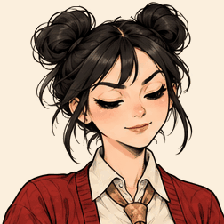

# InkAlive · 妙笔生动

**让笔下人物动起来，一张一张做到位。**

[English](README.md) · [下载技能包](https://github.com/imxiaowho/ink-alive/releases/latest) · [技能入口](skills/ink-alive/SKILL.md)

InkAlive 是一个可复用的 Codex Skill，带本地 Python 制作工具。它串起原画关键帧、背景与静止层稳定、表情动作过渡、GIF 编码和实际画面审计。“妙笔生动”借“妙笔生花”的巧思，InkAlive 则是让墨线活起来。



这张潘娜 GIF 是已确认的效果基准：252 × 252、2 秒，24 个绘制关键画面加 26 个推算过渡画面。它描述的是这条参考，不是其他动作必须照搬的帧数或尺寸。完整素材与参数已随技能保留，在已验证环境中可原样复现。

## 安装和调用

1. 在 [Releases](https://github.com/imxiaowho/ink-alive/releases/latest) 下载独立技能包，或克隆仓库。
2. 把 `ink-alive` 文件夹放进 Codex 用户技能目录。从仓库安装时复制 `skills/ink-alive`；默认目标为 `~/.codex/skills/ink-alive`。
3. 在选定的 Python 环境安装依赖，需要 Python 3.10 或更高版本。
4. 如果新技能尚未显示，开启新的 Codex 会话后再调用。

在仓库根目录执行：

```sh
python -m pip install -r skills/ink-alive/requirements.txt
```

以后直接说：

> 用 $ink-alive，按已确认的参考效果，给这个角色做一张轻轻抬眉的动图。

新原画和图像修复使用宿主提供的内置 imagegen。本地工具负责后续处理，不会自动画出新角色，不要求 GPU，也不调用外部 API。序列图是静态原画，不能称作模型原生生成了 GIF。

## 制作与审计流程

1. 定义一个人物、一个动作、首尾状态、机位和应动／不动的区域。
2. 生成并检查真实关键画面及必要的透明度图，先修人物辨识、肢体和道具。
3. 提取关键帧；按镜头需要固定背景、稳定静止衣服、连接小幅动作。
4. 使用共享调色板、完整不透明画面导出，再实际解码并生成审查图和检查记录。
5. 审计人物／肢体、稳定性、表情动作、边缘／道具、首尾接缝；逐帧查看和正常速度播放分别记录。
6. 把审查记录与当前 GIF、实际证据的哈希绑定，通过所需检查后选定导出，保留旧版。

工具初始状态始终是“视觉审查待完成”。`finalize` 需要完成视觉检查，并有实际播放审查或用户对该文件的明确确认。程序跑通和参考片获认可，都不能替新作品作出观感判断。详见 [制作约定](skills/ink-alive/references/contract.md) 和 [审计记录格式](skills/ink-alive/references/recipe.md)。

## 本地复现这条参考

在仓库根目录执行，输出目录必须是新目录：

```sh
python skills/ink-alive/scripts/gif_tool.py render skills/ink-alive/assets/panna/project.json --out output/panna-v1
python skills/ink-alive/scripts/gif_tool.py inspect output/panna-v1/preview.gif --out output/panna-inspection-v1
```

结果包括 PNG 关键帧、`preview.gif`、对照播放 HTML、实际解码审查图、时长／静态区域／关键画面检查、输入与环境哈希以及待填审查记录。重出文件不会自动变成“已选定”。

新任务从 `init` 开始，提供实际原画和参数。工具命令为 `init`、`render`、`inspect`、`record-review`、`finalize`；完整用法见 [参数与命令说明](skills/ink-alive/references/recipe.md)。

## v1.1.0：独立 PNG 与高清流程

新增 `png_motion.py`：读取按顺序排列的不透明全彩 PNG 关键帧，检查声明的画布像素预算及运动区域之外的固定画面，保留原色 PNG 母版，再单独导出 256 色 GIF。仅运动裁切区域进入补帧，并声明该缓冲区的内存预算；实际原画细节仍需查看，文件尺寸不能证明图片没有预先放大。

本地已完成一个带固定校园走廊背景的 1920 × 1080 潘娜试样，实际走过渲染、解码／原色帧检查、六项视觉审查、正常速度播放采样及绑定母版清单的选定导出。它使用五个实际绘制姿态、十个计时状态，在两秒内输出五十幅图像。旧参考与原处理脚本保持不变。新高清试样原画未加入本公开技能包，也未宣称已获用户认可。

使用自己的高清原画及当前镜头坐标，详见 [独立 PNG 制作与审计](skills/ink-alive/references/native-png.md)：

```sh
python skills/ink-alive/scripts/png_motion.py render /absolute/project.json --out /absolute/render-v1
python skills/ink-alive/scripts/png_motion.py prepare-review /absolute/render-v1
python skills/ink-alive/scripts/png_motion.py record-review /absolute/render-v1 --record /absolute/review.json
python skills/ink-alive/scripts/png_motion.py finalize /absolute/render-v1 --out /absolute/selected-v1
```

睁眼等遮挡变化先补绘真实阶段；可选的面部区域保护需要人工检查坐标，不会自动识别人脸。大动作、运动身体／机位、原生 4K 和跨平台容量尚未验证。高清 GIF 体积可能很大且有减色，剪辑使用全彩 PNG 母版，轻量观看可另出明确标注的视频。

## 范围和验证

已完成这条胸像抬眼／轻点头参考的完整复现，见 [验证记录与限制](docs/VALIDATION.md)。新角色、新角度要重新检查素材、蒙版与坐标；大动作和严重遮挡需补画或拆镜头。细线形变、插帧软化仍需看实际画面。

本技能用于单镜头 GIF。平台发布、定时任务、宠物安装、口播数字人和整片组装不在其流程内。依赖安装、新原画生成与本地后期处理分别进行。

## 许可证

本次发布尚未指定仓库整体许可证。第三方依赖保留各自的许可证。
